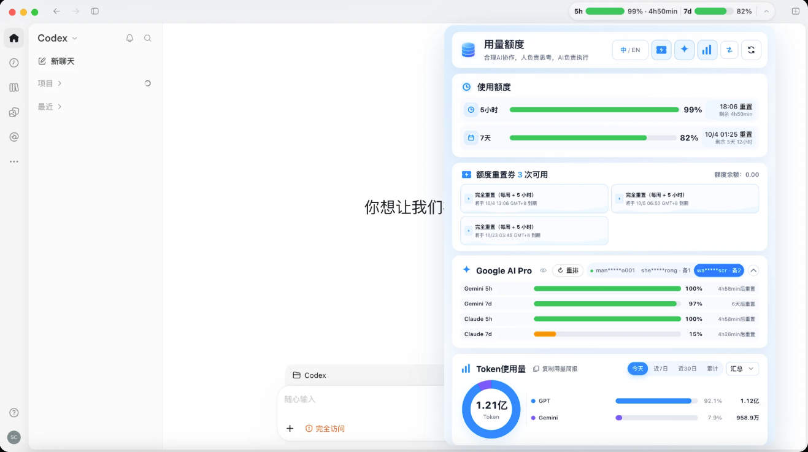

# Codex Quota Header

> A native-feeling usage capsule for the Codex / ChatGPT desktop header. Remaining quota and reset countdowns stay visible.



Chinese: [README.md](README.md)

---

## What changed (2026-10-16)

These behaviors were missing from the previous README:

- **One capsule, stable layout.** Split view and repeated injection keep a single header capsule. When the window is wide enough, the capsule uses the available space and skips containers that have no size. The card title stays pinned while the card scrolls.
- **Visible quota problems.** The capsule shows an inline status dot, and the card shows one status line under the title. Unchanged data is not redrawn. Closing the card keeps keyboard focus and each section's scroll position.
- **Reset-credit states.** The card distinguishes loading, no credits available, and "the available count loaded but the current response has no per-credit details." A temporary missing list keeps the last cards instead of spinning forever.
- **Google account ranking.** Rebalance targets the Gemini model. A generic cooldown copied from another model does not mark an account as cooling while Gemini quota remains. Google quota refreshes immediately after rebalance.
- **Route switching.** "Switching" ends only after the mode actually changes. Failure or a 15-second timeout shows a short failure message and leaves the current mode unchanged. The script selects a Python that can read TOML, so an old system Python no longer makes the button look dead. Set `CODEX_BRIDGE_PYTHON` or `PYTHON` to choose the interpreter.
- **Safety and data.** The plugin no longer guesses a management key. Updated OAuth credentials and local rollups are written with restricted permissions. Token totals remember the file read position, so a restart does not count the same log twice. Expired windows retry with backoff instead of polling every few seconds.
- **Removed controls.** The diagnostics copy button and the token-summary copy button are gone. The token scope footnote is no longer shown at the bottom of the card. Totals still cover only local session logs, not other devices, unsynced sessions, or deleted history.
- **Windows.** The probe matches the listening port exactly and reports pass, fail, or unknown. A native title bar that cannot be injected still stops the probe.

**Known limit:** switching between OpenAI and an external route still runs the bridge `--restart` flow. It can restart Codex and launch `Codex Quota Header.app`. It is not a hot switch. Save in-progress work first.

---

## Why it exists

Deep work in the Codex or ChatGPT desktop app often hits the same interruptions:

- A rate-limit message appears in the middle of a task.
- The remaining 5-hour window and 7-day weekly limit are not visible together.
- Finding the next reset means opening settings or estimating it.

Codex Quota Header puts both values in the top navigation bar, as a capsule and a detail card, without replacing the official client.

---

## Features

### 1. Native-looking header capsule

The frosted capsule follows the official light and dark theme. It mounts between the conversation title and the right-side actions, and does not cover the chat menu, share, pin, or side-panel buttons.

### 2. Quota and countdown at a glance

- **5-hour window:** remaining percentage and progress.
- **7-day limit:** remaining weekly usage.
- **Compact capsule:** the trailing arrow is removed; the weekly percentage closes the capsule.
- **Health colors:** 41%–100% green (`#34C759`), 11%–40% orange (`#FF9500`), 0%–10% red (`#FF3B30`), and no data gray (`#8E8E93`).
- **Weekly ceiling:** when the 7-day limit is 0%, the effective 5-hour value is also shown as 0% red. Each window still keeps its own reset time.

### 3. Detail card

Hover or click the capsule to open the card. Leaving it waits 240 ms before closing. Clicking outside or pressing Esc also closes it.

- The slogan is “合理AI协作，人员负责思考，AI负责执行”.
- The `中 / EN` control updates the capsule and card immediately and remembers the choice.
- Three icons show or hide reset credits, Google AI Pro, and token usage. Refresh stays at the far right.
- The main quota uses four columns: name, progress, percentage, and reset information.
- Up to three reset cards stay on one row. Narrow windows scroll horizontally instead of wrapping. An empty ticket state is used when none are available.
- The card is about 600 px wide and aligns with the capsule.

### 4. Google AI Pro

- The sparkle switch shows or hides the module. While hidden, it does not poll.
- Ranking uses the same rule as the `codex-autoheal-bridge` skill: shorter remaining time until the 7-day reset comes first; equal weekly times use the 5-hour reset; accounts with zero 5-hour quota follow available accounts; plan level is only a later tie-breaker.
- The active account is marked in use. Alternates are numbered. Exhausted or cooling accounts show a cooling mark.
- Another model's cooldown, or a generic cooldown with the same recovery time, does not mark an account as cooling while its Gemini 5-hour quota remains.
- Rebalance applies the same order to the Gemini model and refreshes this module when it finishes.
- The rebalance explanation appears only while the pointer is over the button and does not push the rows below it.
- The arrow next to Claude collapses only the Claude rows. Gemini 5-hour and 7-day rows stay visible.
- Countdowns are recalculated every second, capped for the 5-hour window, and refreshed quietly after expiry.

### 5. Local token totals

No external database and no upload. The plugin reads local Codex session logs incrementally.

- The chart switch shows or hides the module and pauses scanning while hidden.
- Ranges are today, last 7 days, last 30 days, and all time. Days older than 32 roll into a permanent total.
- The global total sits above the chart and hides when it would repeat the chart center.
- More than three models show the top three, then `Other (N models)`. Expanding shows the rest and provides a collapse control.
- One model uses a full-width card. Two models use two equal cards.
- Chinese uses 万 / 亿. English uses K / M / B.
- The first run builds 32 days of daily totals in the background. Later scans read only new log bytes about every 30 seconds. Changing the range or model family stays in memory.
- The read position is kept when old days are pruned, so restarting the monitor does not add the same log twice.

### 6. Responsive capsule

The capsule moves through full, compact, minimal, and nano layouts. A wide window shows the full capsule. A very narrow window still keeps the core quota mark. Positioning skips `display: contents` containers so their missing size is not subtracted twice.

### 7. Refresh feedback

The refresh button updates the main quota, reset credits, the current Google account, and token totals. Each source keeps its own result: one failure does not erase another source that already refreshed. Previous values stay visible, the icon spins, and numbers use a light loading treatment until the new values arrive.

### 8. Empty states

Reset credits, Google AI Pro, and token usage each have their own empty card. Reset credits separately show loading, confirmed empty, or a count without per-credit details. The last case does not keep the spinner. If cards were already shown, the last cards remain.

### 9. Plan-aware rows

Plus accounts show the 5-hour and 7-day windows. Other plans show the 7-day window.

### 10. Local-only data and recovery

The background process reads Codex App Server, CLIProxyAPI, and loopback endpoints. The page receives only sanitized quota and token snapshots. OAuth tokens and management keys stay in the background process, are not written to plugin logs, and are not uploaded. Conversation text is not read for Google quota. The capsule remounts across chat pages, new chats, task switches, and reloads.

- A missing management key is not replaced with a guessed password. Updated OAuth files and local rollups are written atomically with restricted permissions.
- One monitor and one header capsule stay active. Extra capsules from split view or repeated injection are removed.

### 11. Header placement and route switch

- On the home and new-chat pages, the capsule sits to the left of the native new-chat button. If that button cannot be found, it aligns to the right of the header.
- The route button is immediately left of refresh and is 32 × 32 px.
- Switching stays in progress until the mode changes. A script error or no completion within 15 seconds shows a short failure and keeps the previous mode.
- The bridge script needs Python that can read TOML. The plugin tries `python3`, `python3.13`, `python3.12`, `python3.11`, and the same names under `~/.local/bin`. `CODEX_BRIDGE_PYTHON` or `PYTHON` overrides the search.
- The switch runs `quota_failover.py toggle --apply --restart`, then launches `Codex Quota Header.app` after the command returns. This can restart the desktop client. Save work first.

---

## Install

### Requirements

- **macOS:** macOS 12 or later, [Node.js](https://nodejs.org/) 18 or later, and ChatGPT.app or Codex.app.
- **Windows (`windows` branch):** Windows 11 x64 (build 22000 or later), Node.js 18 or later, and the Store/MSIX or standalone ChatGPT client.

### Windows and the P0 probe

Run the probe before installing. It checks the Store alias, loopback CDP binding, and whether the webview header can be injected:

```powershell
.\bin\win-probe.ps1
node bin/win-probe.mjs
```

`[STOP]` means the title bar is owned by the native DWM/WinUI title bar and cannot be injected. The probe stops instead of trying to enter the sandbox.

Port matching is exact. Loopback-only is pass, another address is fail, and a probe command error is unknown. Unknown is not treated as pass.

Install as the normal user, not as administrator, so the AppData directories belong to that user:

```powershell
.\bin\install.ps1
```

The installer checks Windows 11 x64 and Node.js 18+, stores settings in `%APPDATA%\Codex Quota Header`, stores token totals and logs in `%LOCALAPPDATA%\Codex Quota Header`, installs the plugin under `%USERPROFILE%\.codex\plugins\codex-usage-header`, creates Desktop and Start menu shortcuts, and runs the probe again.

Start it from the **ChatGPT (Quota Header)** shortcut, the `codex-header` command in `%USERPROFILE%\.local\bin`, or `bin\codex-header.cmd` / `bin\codex-header.ps1`.

```powershell
.\bin\uninstall.ps1
.\bin\uninstall.ps1 -Purge
```

The first command keeps settings and token totals. `-Purge` also removes the AppData directories.

### macOS

From this repository:

```bash
./bin/install.sh
```

The script copies the plugin to `~/.codex/plugins/codex-usage-header`, installs `~/.local/bin/codex-header`, and creates **Codex Quota Header.app** in Applications. Drag that app to the Dock. If Codex is already open without the debug channel, the launcher restarts it onto that channel.

To update an existing install:

```bash
git pull
./bin/install.sh
codex-header --inject-only
```

`--inject-only` reloads the header without quitting Codex. The next launch through the app also picks up the installed copy.

---

## Google AI Pro setup

- Codex 5-hour and 7-day quota needs no Google account, Antigravity, CLIProxyAPI, or Google OAuth.
- Google AI Pro needs a working local Antigravity OAuth account and CLIProxyAPI / model bridge. The module is off until the sparkle switch is turned on.
- Token totals do not need Google. They read `~/.codex/sessions`, and the first scan may take a while.

A new Google setup needs:

1. macOS, Node.js 18+, and a signed-in Codex or ChatGPT desktop app.
2. At least one enabled Antigravity file:

   ```text
   ~/.cli-proxy-api/
   ├── config.yaml
   └── antigravity-<account>.json
   ```

   The file needs a valid `access_token`. Automatic renewal also needs `refresh_token`. `.bak` files are ignored.
3. OAuth client credentials from `ANTIGRAVITY_CLIENT_ID` and `ANTIGRAVITY_CLIENT_SECRET`, or the existing `~/.config/codex-cli-model-bridge/codex-model-router.mjs`.
4. Reachability for `http://127.0.0.1:8317`, `https://oauth2.googleapis.com`, and `https://daily-cloudcode-pa.googleapis.com`. Use the bridge's existing port and auth directory; do not start a second bridge for the plugin.
5. A local management key in `remote-management.secret-key` or `MANAGEMENT_PASSWORD`. Keep it local and out of Git. If the management API is unavailable, a valid Google access token can be used directly. An expired account still cannot be shown.

```yaml
remote-management:
  allow-remote: false
  secret-key: "<local management key>"
```

Do not paste access tokens, refresh tokens, or client secrets into the plugin. Sign in through the existing bridge, confirm port 8317, then enable Google AI Pro. Enable the chart separately for token totals. The plugin reads the bridge's local files and quota results; it does not create its own account pool or complete Google login for you.

These checks print names and status only, not OAuth contents:

```bash
test -d "$HOME/.cli-proxy-api" && echo "auth dir: OK" || echo "auth dir: MISSING"
test -f "$HOME/.cli-proxy-api/config.yaml" && echo "config: OK" || echo "config: MISSING"
find "$HOME/.cli-proxy-api" -maxdepth 1 -type f \
  -name 'antigravity-*.json' -not -name '*.bak' -print
curl -sS -o /dev/null -w 'CLIProxyAPI: %{http_code}\n' \
  'http://127.0.0.1:8317/v1/models'
codex-header --status
```

| Data | Default location | Notes |
| --- | --- | --- |
| Antigravity OAuth | `~/.cli-proxy-api/antigravity-*.json` | Created by the bridge; do not write or commit it |
| CLIProxyAPI config | `~/.cli-proxy-api/config.yaml` | May contain the local management key |
| Model bridge client credentials | `~/.config/codex-cli-model-bridge/codex-model-router.mjs` or environment variables | Used only for OAuth refresh |
| Plugin settings | `~/Library/Application Support/Codex Quota Header/settings.json` | Module switches, refresh interval, and timezone. Default timezone is `Asia/Shanghai` |
| Token rollup | `~/Library/Application Support/Codex Quota Header/token-rollup.json` | Local only |
| Codex session logs | `~/.codex/sessions` | Missing logs affect token totals only |

`timezone` accepts an IANA name such as `America/Los_Angeles`. Restart the monitor after changing it. Daily totals are rebuilt from local logs in the new timezone and are not mixed with the old one. Calendar ranges follow local dates, including daylight-saving changes.

| What you see | Usual cause | What to do |
| --- | --- | --- |
| No account or no data | No matching `antigravity-*.json`, or the account is disabled | Sign in through the bridge and confirm the file is not a `.bak` |
| Token expired or refresh failed | Invalid refresh token or missing client credentials | Sign in again and check the environment or bridge config |
| CLIProxyAPI 401 | Management key mismatch or old config | Check `MANAGEMENT_PASSWORD` and `secret-key`, then restart the existing bridge |
| CLIProxyAPI does not respond | Bridge stopped, wrong port, or wrong auth directory | Check the existing bridge; do not start a second one |
| Google 403 or 429 | Account eligibility, service policy, or temporary limiting | Check the account in the bridge; this is not a header-injection failure |
| Values stay old | Temporary network or OAuth failure | Restore the connection or sign in, then refresh. The last valid snapshot stays visible |
| Token totals say they are building | First historical scan | Wait. Google setup does not affect token totals |

Do not put `access_token`, `refresh_token`, `ANTIGRAVITY_CLIENT_SECRET`, `MANAGEMENT_PASSWORD`, `secret-key`, or files containing them into the README, an issue, a screenshot, or Git. The Google quota endpoint can change. Codex quota and header injection still work when the Google module does not.

---

## Using the card

- Hover the capsule to open it, move away to close it, or click to toggle it.
- Tab to the capsule, press Enter or Space to open it, and press Esc to close it.
- Refresh from the button in the card. The header capsule has no refresh button.
- Reset credits show the available count and each card's expiry. There is no extra popup.
- The reset-credit icon is a local compressed green card, under 100 KB.
- Language switching updates the capsule and card. Refresh frequency stays in the settings file.
- A long card keeps its title pinned. Reopening it restores scroll position and keyboard focus.
- Hiding the window closes the card. After returning, move the pointer into the capsule again; the old hover state is not kept.
- The capsule follows chat pages, task sessions, and new chats. If it cannot find a safe gap, it does not cover native buttons.

---

## FAQ

### 1. Why start Codex Quota Header.app instead of the original icon?

The official Electron app does not expose an injection channel by default. The launcher only starts it with the local CDP channel. It does not modify files inside the official app.

### 2. What if it says Node.js cannot be found?

The monitor needs Node.js. Finder does not always load shell environment variables. Homebrew paths `/opt/homebrew/bin/node` and `/usr/local/bin/node` are already checked. For nvm or another install, set:

```bash
export CODEX_USAGE_HEADER_NODE="/actual/path/to/node"
```

### 3. Why does quota say unavailable or keep loading?

Check that the desktop client is signed in and online. After signing in, open the card and refresh it.

After a desktop upgrade, update the plugin, run `./bin/install.sh`, then `codex-header --inject-only`. The 26.924 built-in CLI lives at `Contents/Resources/codex-cli/bin/codex`. The plugin finds the running ChatGPT or Codex app and supports old, new, and Homebrew paths. `targets[].appServer` in `codex-header --status` shows the binary path, version, initialization state, and fixed fault type. It does not include credentials or raw error text.

### 4. Why does the capsule disappear after refresh or a new chat?

The monitor checks the current CDP page and injects again after a reload. If it is still missing, run `codex-header --status`, then `codex-header --inject-only`.

Newer Work headers can nest actions in several `display: contents` containers. The plugin skips those sizeless containers and uses the native action group. It also accepts an explicit app-shell toolbar without a `header` tag. It injects only the local main chat or work page, not payment pages, avatar popovers, or separate windows. The command launcher reads the installed copy, not the project directory, so reinstall after editing source.

### 5. Why does hover not open the card?

The header is a native drag region. The current capsule has its own hit area and a page-coordinate fallback. After installation, `mountedCount` in `codex-header --status` should be `1`. Run `codex-header --inject-only` if it is not.

### 6. Why does the 5-hour value become 0% when the weekly limit is exhausted?

The weekly limit is the account ceiling. Once it is exhausted, a theoretical remainder in the 5-hour window cannot be used. The effective value is shown as 0% red, while both reset countdowns remain.

### 7. Why do reset credits say the count loaded but details did not?

Some quota responses include only the available count. The card says the details are unavailable instead of treating the count as zero or leaving the spinner running. The cards return when a later response includes them.

### 8. Why does route switching seem to do nothing?

Confirm that `codex-autoheal-bridge` is installed and that Python can read TOML: Python 3.11 or later, or Python with `tomli`. An older system Python is skipped. A real failure shows a switch-failed message and keeps the current mode. Point `CODEX_BRIDGE_PYTHON` at a working interpreter and try again.

### 9. How do I uninstall it?

```bash
./bin/uninstall.sh
```

This removes the plugin files, command entry, and `Codex Quota Header.app`. Remove a Dock icon separately.

---

## Development

```bash
codex-header --status
codex-header --inject-only
npm test
npm run test:live
```

`test:live` needs the desktop client to be running.

```text
codex-usage-header/
├── assets/                 # Icons and preview
├── bin/
│   ├── install.sh          # macOS installer
│   ├── uninstall.sh        # macOS uninstaller
│   ├── codex-header        # Command launcher
│   └── ...                 # Windows scripts and macOS app config
├── src/
│   ├── injected.js         # Header UI
│   ├── launcher.mjs        # Client launch and CDP injection
│   ├── account-client.mjs  # Codex App Server client
│   ├── desktop-runtime.mjs # Desktop app and built-in CLI discovery
│   ├── account-health.mjs  # Sanitized account health
│   ├── failover-mode-adapter.mjs # Route mode and switching
│   ├── dynamic-priority-adapter.mjs # Account priority
│   ├── extended-usage.mjs  # Gemini quota and token rollup
│   ├── monitor.mjs         # Single-instance refresh and broadcast
│   ├── platform-paths.mjs  # macOS and Windows data paths
│   └── utils.mjs           # Colors and countdown helpers
└── test/                   # Unit and live tests
```

---

## Disclaimer

This is a community efficiency extension, not an OpenAI product. A major desktop update that changes the header may require a new mounting adapter.
